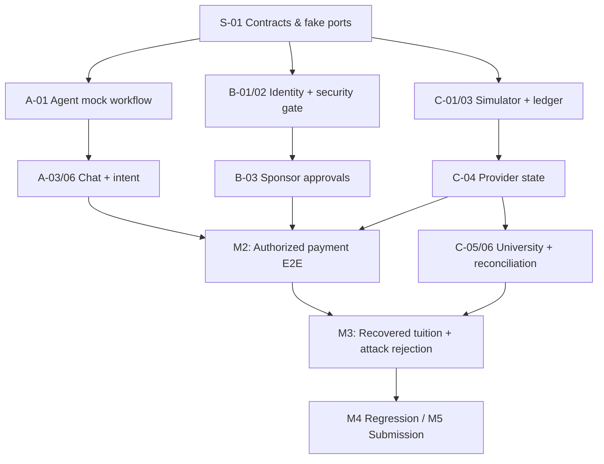

# TuitionRelay / TraceBack — Implementation Roadmap & Tickets

> **Version:** 1.0 — 16 October 2026  
> **Deadline:** 20 October 2026, 23:59 Beijing time = **22:59 WIB**  
> **Team:** 3 developers, full time until deadline  
> **Source of truth:** `TuitionRelay-MVP-Spec.md` (product scope and detailed domain semantics).  
> **Name:** TuitionRelay is provisional; TraceBack remains a working codename.  
> **Geography:** Indonesia → mainland China primary simulation; Southeast Asia → China architecture extensible.  
> **Non-negotiable:** All payments, university records, quotes, policies, and identities in the demo are **synthetic**. No claimed access to live bank or Chinese university APIs.

## 1. Delivery objective

By the competition submission, demonstrate **one complete, replayable, instrumented financial mission**:

1. Authenticated student asks an agent to pay a fictional Chinese university tuition obligation in CNY, using an IDR sponsor-owned account.
2. Agent retrieves obligation, trusted beneficiary, synthetic provider quote and institution policy; shows full landed cost.
3. Student requests payment; sponsor approves exact immutable terms in a separate authenticated dashboard.
4. Protected executor verifies funding ownership, recipient trust, approval, risk, limits and quote validity **inside the execution transaction**; simulated payment debits **once**.
5. Provider reports `DELIVERED`, but the university obligation remains `UNPAID`/`EXCEPTION` because the student reference is missing.
6. Agent investigates evidence, creates/submits a case; separate simulated university service checks evidence, posts tuition **once**, and updates obligation to `PAID`.
7. In a second scripted branch, a malicious invoice/email directs the agent to change the university beneficiary. The backend **holds** the action; no payment is made to the wrong beneficiary.
8. Student and sponsor see only the status and evidence they are authorized to view; audit results can be inspected on the demo page.

**First complete happy-path gate:** student request → approved transfer → correct provider state by **18 Oct**.  
**First full differentiated hero demo:** approved transfer → delivered-but-unposted → reconciliation → verified tuition credit by **19 Oct**.

### P0 / P1 / P2 meanings

- **P0 (must ship):** Without this, the core 40% completion or 30% security story is compromised.
- **P1 (important):** Include once the hero flow works; supports three exception types and interaction breadth.
- **P2 (cut first):** Regional breadth, UI polish, extra educational KB, advanced automation. Not part of mandatory launch gate.

**Never cut:** owner-bound approval, policy gate on every mutation, immutable intent terms, idempotency, provider/university state separation, one real simulated reconciliation result, or attack blocking.

## 2. Ownership boundaries

| Owner | Files/modules exclusively owned | Feature responsibilities | UI surfaces |
|---|---|---|---|
| **Dev A — Agent & Knowledge** | `backend/agent/`, `backend/kb/`, `frontend/app/student/chat/`; can own student *read-only* status panel in chat | LangGraph orchestration, typed tool adapters, dialog, pause/resume, knowledge with provenance, exception triage, bilingual outputs | `/student/chat` |
| **Dev B — Security & Authority** | `backend/authz/`, `backend/approvals/`, `backend/fraud/`, `frontend/app/sponsor/` | Authenticated identity/scope, sponsor mandate, T0–T3 gate, terms-hash approvals, fraud rules/LLM assessment, holds | `/sponsor/approvals` |
| **Dev C — Financial Simulator** | `backend/finance/`, `backend/university/`, `backend/demo/`, migrations/seeds, `frontend/app/student/payments/`, `frontend/app/demo/` | Quotes, payment intents and ledger, provider outcomes, university postings, reconciliations, simulation reset and fixture injection | `/student/payments`, `/demo` |

**Shared files:** `backend/contracts/`, `frontend/lib/api-contracts/`, `backend/main.py`, root config and DB migrations. One assigned reviewer owns merges to each shared file; no uncoordinated interface changes. Prefer generated TypeScript models from a frozen OpenAPI schema rather than hand-copying API definitions.

**Proposed lightweight technology:** Python/FastAPI + LangGraph, PostgreSQL, Next.js. One backend process, one frontend, one DB; **no microservices**. Deploy to any suitable existing platform, with Docker Compose as a predictable local fallback.

## 3. Day-zero shared contract (16 Oct: timebox 90–120 minutes)

All three attend; **A leads contract drafting, B signs off security semantics, C signs off data/state semantics**.

Freeze and commit:

- **Fixture aliases:** `stu_001`, `par_001`, `acct_idr_01`, `uni_cn_01`, `obl_2026_demo_01`, `benef_uni_cn_01`, `quote_001`, plus test-scenario IDs.
- **Typed Pydantic models:** `ActorContext`, `Money`, `FxQuote`, `TuitionObligation`, `PaymentIntent`, `Approval`, `PolicyDecision`, `PaymentResult`, `ReconciliationCase`, `ToolResponse`, `DomainError`.
- **Financial semantics:** integer minor units, currencies IDR/CNY, immutable `terms_hash`, idempotency keys, actor from authenticated session not request body, university posting separate from provider delivery.
- **Ports:** `AuthorizationPort.evaluate(actor, action)`, `PaymentPort.execute(intent_id, key, actor)`, `PaymentPort.status(id, actor)`, `UniversityPort.obligation(id, actor)`, `UniversityPort.reconcile(case_id, actor)`.
- **Common errors:** `FUNDING_OWNER_APPROVAL_REQUIRED`, `BENEFICIARY_MISMATCH`, `APPROVAL_TERMS_MISMATCH`, `QUOTE_EXPIRED`, `PROVIDER_OUTCOME_UNKNOWN`, `SECURITY_HOLD`, `POSTING_WINDOW_ACTIVE`, etc.
- **HTTP prefixes:** all documented `/api/v1/...` endpoints from the MVP spec, with minimum request/response shape frozen.
- **Shared mocks:** `FakeAuthorizationPort` to unblock C; `FakePaymentPort` and `FakeUniversityPort` to unblock A; fake quote/account repositories to unblock B.
- **One clean-start command:** `docker compose up --build` plus `pytest` fixture/contract smoke command, owned by A with C supporting DB.

**Exit gate M0:** A mock-backed student chat can request a payment intent, fake sponsor decision can be queried, and fake executor returns a typed state response; all work in independent branches. This is a contract smoke check, **not** an unsafe bypass in the real executor.

**Change control:** The interface's field names, money units, approval rules, and state transitions cannot change by one developer alone. Agree in team chat, update contract + mock + test, then merge.

## 4. Ticket backlog

Each ticket includes a single owner and binary acceptance checks. `↳` denotes the only required upstream dependency, beyond M0. Estimated effort is a planning guess, not a guarantee.

### Shared kickoff tickets

| Ticket | Owner | Pri | Target | Effort | Depends | Acceptance |
|---|---|---|---|---|---|---|
| **S-01 Contract freeze** | A lead + all review | P0 | Oct 16 | 2h | None | Pydantic objects, enums, ports, HTTP paths, sample payloads, contract tests committed; all approve |
| **S-02 Repo + test/deployment skeleton** | A | P0 | Oct 16 | 2h | S-01 | FastAPI & Next.js boot; DB connectivity stub; pytest runs; lint/test CI available; `.env.example` without secrets |
| **S-03 Seed DB & scenarios** | C | P0 | Oct 17 AM | 3h | S-01 | Postgres schema/migration, isolated demo tenant, deterministic fixtures, reset command and fixture IDs stable |

### Dev A — Agent, knowledge and student chat

| Ticket | Pri | Target | Effort | Depends | Acceptance |
|---|---|---|---|---|---|
| **A-01 Graph / typed tools** | P0 | Oct 17 AM | 3h | S-01 | Graph handles `ASK_POLICY`, `TUITION`, `ALLOWANCE`, `TRACK`, `RECOVER`, `VERIFY_MESSAGE`; calls mocked ports; never directly accesses DB |
| **A-02 University KB + quote explanation** | P0 | Oct 17 | 3h | S-01 | Synthetic `uni_cn_01` rules + cited ZJU reference with `synthetic` and validity flags; quote costs correctly explained, not shown as live FX |
| **A-03 Tuition intent + clarification** | P0 | Oct 17 | 4h | A-01, fake ports | Unambiguous request → quote/payee/intent preview; missing info → only necessary questions; never transfer before approval |
| **A-04 Approval wait/resume** | P0 | Oct 18 AM | 3h | A-03 + B-03 interface | After request agent reports `AWAITING_APPROVAL`; a student-initiated “check/continue” turn reads real server approval then executes via protected tool; fake text approvals rejected |
| **A-05 Recovery investigator** | P0 | Oct 18–19 | 4h | A-01 + C-06 interface | Missing-reference evidence → create/submit case → verify ledger state; cannot directly post university ledger; `OUTCOME_UNKNOWN` does not retry blind |
| **A-06 Student chat page** | P0 | Oct 17–18 | 4h | S-01 | Chat, action summary, quote, approval-pending status, error/recovery steps shown from mock API; handles source/actor session properly |
| **A-07 UX, language and fallback tests** | P0 core / P1 polish | Oct 19 | 3h | A-03–A-05 | UX-01..05; English student + Bahasa Indonesia sponsor summaries; unknown policies trigger safe fallback; concise explanations |

**A's independent first-day demo:** Student chat describes a CNY obligation, shows mock IDR→CNY quote, requests sponsor approval, and visibly waits. No real payment code required at this point.

### Dev B — Security, authorization and sponsor UX

| Ticket | Pri | Target | Effort | Depends | Acceptance |
|---|---|---|---|---|---|
| **B-01 Demo authentication + scoped access** | P0 | Oct 17 AM | 3h | S-01 | Student and parent authenticate separately; verified actor derived server-side; student cannot access sponsor-only decisions; consent controls data visibility |
| **B-02 Policy gate / T0–T3** | P0 | Oct 17 | 5h | B-01 + fake account repo | Hard checks for owner, beneficiary, limits, balances, expired quote, holds, mandate, current state; returns `ALLOW/REQUIRE_APPROVAL/HOLD/DENY` + reason; never trusts LLM classifier for permission |
| **B-03 Bound approvals and mandates** | P0 | Oct 17–18 | 4h | B-01–B-02 | Authenticated owner approves exact `terms_hash`; change invalidates; expiry and single-use enforced; allowance mandates cumulative including reservations |
| **B-04 Sponsor approval dashboard** | P0 | Oct 18 | 3h | B-03 contract | Parent sees authorized transaction amount/currency/payee/cost, approves or rejects via protected UI; text pasted into student chat is not approval |
| **B-05 Fraud hard rules + LLM assessment** | P0 minimal hybrid / P1 tuning | Oct 18–19 | 4h | B-02 + KB adapter | Changed or unverified beneficiary always held; semantic classifier returns advisory indicators only; valid known payee remains usable after compliant authorization |
| **B-06 Holds, audit and security cases** | P0 essentials / P1 case UX | Oct 18–19 | 3h | B-02 | Agent can place hold but cannot clear it; audit has actor/decision/reason and redacts secrets; unrelated actors cannot see each other's case |
| **B-07 Security regression suite** | P0 | Oct 19 | 4h | B-02–B-06 | SEC-01..09 checks database effects, not chat wording; key no-debit, forged approval, prompt-injection and changed terms tests pass |

**B's independent first-day demo:** In two separate authenticated sessions, a student requests a sponsor-funded tuition transfer and the sponsor approves immutable terms. A forged pasted approval is rejected. Uses fake finance backend.

### Dev C — Payment, university simulator and status/demo

| Ticket | Pri | Target | Effort | Depends | Acceptance |
|---|---|---|---|---|---|
| **C-01 Database migrations + fixture reset** | P0 | Oct 17 AM | 3h | S-01 | Repeatable seed with accounts, obligation, beneficiary, two synthetic quotes, scenario flags; no live account identifiers |
| **C-02 Obligation, trusted beneficiary, FX quotes** | P0 | Oct 17 | 3h | C-01 | `GET` endpoints return authorized CNY balance, masked verified recipient, IDR→CNY quote math, quote expiry and provenance |
| **C-03 Payment intents + ledger executor** | P0 | Oct 17–18 | 7h | C-01 + B-02 interface | Create intent, immutable terms; `execute` invokes real gate inside protected transaction; one debit per idempotency key; no overdraw; audit exists |
| **C-04 Provider state / timeout / duplicate control** | P0 core / P1 fault inject | Oct 18 | 3h | C-03 | `PROCESSING→DELIVERED`, `FAILED`, `OUTCOME_UNKNOWN`; retry checks original reference, no duplicate debit or unearned `FAILED` |
| **C-05 University obligation + posting service** | P0 | Oct 18 | 3h | C-01 | Provider `DELIVERED` does not imply tuition `PAID`; privileged simulated university service posts ledger once and verifies account balance |
| **C-06 Reconciliation cases / all three exceptions** | P0 basic branches / P1 advanced automation | Oct 18–19 | 5h | C-04–C-05 | Missing reference → verified posting after authorized case; delayed posting → `AWAITING_POSTING` without duplicate; shortfall → exact difference and policy-gated top-up proposal or escalation. All three basic branches implemented |
| **C-07 Payment status + demo pages** | P0 minimum / P1 polish | Oct 19 | 3h | C-02–C-06 endpoint contracts | `/student/payments` shows provider vs university state; `/demo` resets fixtures, injects expected scenarios and views redacted audit |
| **C-08 Financial tests and concurrency** | P0 | Oct 19 | 4h | C-03–C-06 | TC-01..10; at-most-one debit/post, no negative balance and no duplicate after concurrent retries |

**C's independent first-day demo:** Send a synthetic payment to a verified beneficiary through a fake gate and see distinct provider settlement and institution posting states. Fake gate is isolated and replaced before integrated submission.

## 5. Integration checkpoints and chronology

| Time (WIB) | Milestone | Required evidence | Decision |
|---|---|---|---|
| **Thu, Oct 16 — tonight** | **M0: Interface freeze** | Contract build, fake adapters, seed IDs, branches assigned | No feature coding against incompatible schemas |
| **Fri, Oct 17 — afternoon** | **M1: Independent demos** | A mock chat, B authenticated sponsor approval, C fake-gated ledger all run | Fix contract mismatches immediately |
| **Sat, Oct 18 — by evening** | **M2: First vertical slice** | Student request → sponsor approval → policy-gated simulated debit → status visible; confirmed one debit | Stop ancillary features until this is green |
| **Sun, Oct 19 — afternoon** | **M3: Differentiation and attacks** | Missing-reference correction reaches university `PAID`; fake beneficiary attack gets HOLD; repeated payment no duplicate | Prioritize failing P0 tests |
| **Sun, Oct 19 — evening** | **Feature freeze** | All P0 code integrated, regression script, synthetic status banner | No new KB/countries/scam features |
| **Mon, Oct 20 — morning/afternoon** | **M4: Demo stable** | Fresh reset → hero test → attack test → audit output, deployed endpoint, demo recording | Bug fixes and evidence only |
| **Mon, Oct 20 — target submit by 19:00 WIB** | **M5: Submission** | Final artifact/video/report/link uploaded and verified | ~4h buffer to official **22:59 WIB** cutoff |

**Daily integration discipline:** 15-minute stand-up; 15-minute contract check after lunch; end-of-day smoke demo. Merge short PRs rather than waiting for massive feature branches. Use environment fixtures to ensure no developer requires another's unfinished module. Keep `main` green.

## 6. Minimal dependency graph

**Anti-blocking tactics:**

- A talks to `FakePaymentPort` until actual provider endpoints are ready; B talks to mock balances/accounts; C talks to `FakeAuthorizationPort` until B's gate is ready.
- **Never ship the fake gate** in integrated execution. Add a runtime/integration assertion rejecting fallback stub gate in non-test environment.
- A does not rely on asynchronous push notifications for sponsor approval initially. The verified approval persists server-side; the student says “check payment” or clicks *Continue*, and the agent reloads state. Automatic resume is P2.
- Do not let the LLM generate DB writes, authenticated sponsor decisions, or university posting calls.
- Keep one fixture for the core demo, with extra fixture permutations rather than extra external integrations.
- For demo UI work, use mocks from M0, not hand-coded responses or fixture-specific business shortcuts.

## 7. Test-to-ticket traceability

| Test group | Main owner | Ticket(s) | Go/no-go critical |
|---|---|---|---|
| `TC-01`–`TC-02` obligation/quotes | C + A explanation | C-02, A-02/03 | Yes |
| `TC-03` sponsor-approved tuition | B/C/A | B-02/03/04, C-03, A-04 | **Yes** |
| `TC-04` student-owned payment | B/C | B-01/02, C-03 | Yes |
| `TC-05` allowance mandate | B/C | B-03, C-03 | Yes if living allowance shown |
| `TC-06`–`TC-07` duplicate/timeout | C | C-03/04/08 | **Yes** |
| `TC-08` missing-reference reconciliation | C + A | C-05/06, A-05 | **Yes** |
| `TC-09` delayed posting | C + A | C-05/06, A-05 | **P0 minimal branch**; no false-paid result |
| `TC-10` shortfall | C + A + B | C-06, A-05, B-02 | **P0 minimal branch**; no unapproved top-up |
| `SEC-01`–`SEC-03` role/approval/limit | B | B-01/02/03/07 | **Yes** |
| `SEC-04`–`SEC-05` injection/payee | B + A | B-05/07, A-01/05 | **Yes** |
| `SEC-06`–`SEC-08` leakage/hold/terms | B | B-01/02/03/06/07 | **Yes** |
| `SEC-09` valid payment still possible | B + C | B-05, C-03 | Yes |
| `UX-01`–`UX-05` dialog/fallback | A | A-03/04/05/07 | P1 breadth; at least clarification + safe fallback P0 |

**Automated assertion priority** (in this order): zero unauthorized debit → exactly-once debit → approval ownership → university posting not inferred from provider status → recovery once → correct fallback. Test end state **and** forbidden intermediate effects; an unauthorized debit later reversed is still failure.

## 8. Release readiness checklists

### Must pass for live demo

- [ ] Fresh clean-start works without manually editing DB rows.
- [ ] Two distinct verified demo sessions: student and sponsor; roles cannot be changed by chat.
- [ ] Agent shows synthetic IDR→CNY quote with explicit cost/fee estimate and approved beneficiary.
- [ ] Parent approval is server-recorded and bound to amount/payee/quote/terms hash.
- [ ] Real protected executor and gate are active (no fake security bypass).
- [ ] Exactly one debit appears in ledger, with idempotent duplicate retry.
- [ ] Provider delivered is visibly different from university posting.
- [ ] Missing-reference case finds evidence; privileged simulator posts exactly once.
- [ ] Fraudulent beneficiary change holds and creates **zero** unauthorized debit.
- [ ] Safe error/fallback for provider unknown and missing policy; no invented success.
- [ ] Audit output is redacted, and student/sponsor only see authorized data.
- [ ] Demo recorded on the deployed build; code, video and report match same state.

### If behind schedule, cut in this order

1. P2: extra countries/currencies beyond the required primary IDR→CNY corridor.
2. P2: decorative UI and rich charts.
3. P2: background automatic resumption and outbound notifications.
4. P1: broad educational KB (visa, tax, credit building) and multi-university support.
5. P1: sophisticated scam scoring/model tuning (keep hard payee/auth rules and one safe LLM classification case).
6. P1: elaborate secondary exception UI or fully automated top-up. **Keep both P0 basic branches:** delayed posting yields `AWAITING_POSTING` and a recheck; shortfall yields an exact discrepancy with a permitted next action or escalation. Keep the polished hero demo focused on missing-reference recovery.

**Do not cut to meet schedule:** the security gate, sponsor identity separation, one approved transfer, idempotency, and one verified exception-resolution pathway.

## 9. Integration and failure-response protocol

- Branch pattern: `feat/a-agent-*`, `feat/b-security-*`, `feat/c-finance-*`, `fix/integration-*`.
- Every PR: mention ticket ID, changed contract fields (if any), test commands, demo screenshot/JSON, and security implications.
- Contract break: stop merge, make tiny 3-person decision, update shared models/mocks/test, then resume. Don't silently patch each consumer.
- If an endpoint is late: retain typed stub and continue module tests; do not fake a real financial success in final integrated demo.
- If provider error is ambiguous: mark `OUTCOME_UNKNOWN`; query original provider reference before any retry.
- If a case cannot be posted: end at `ESCALATED` with case ID and explanation, never fabricate `PAID`.
- If a security test fails: block release of payment features until negative-state assertions pass.

## 10. Demo, report and final submission allocation

- **Dev A:** write the 3-minute demo dialogue and agent decision trace, source citations, screenshot of clarification and recovery.
- **Dev B:** assemble the attack script, show protected policy responses, approval proof and security audit.
- **Dev C:** seed/replay final demo fixture, provide ledger/tuition verification screenshots, deploy/reset and capture status screens.
- **All three:** run the hero story once from scratch, then run attack branch independently, then verify upload and links. Final submitted materials must say **simulated** wherever relevant.

## 11. Recommended immediate starting sequence

1. Hold the M0 contract freeze and assign final ownership of shared files **tonight**.
2. Dev A scaffolds FastAPI/Next.js/LangGraph mock agent and generates example run envelopes.
3. Dev B implements immutable approvals and a pure deterministic policy function against stub account records.
4. Dev C builds Postgres migrations plus seeded obligations/accounts and the protected executor against a fake gate.
5. Merge the earliest vertical-slice pieces by 18 Oct; then implement recovery and adversarial paths.

---

*Source basis:* The approved `TuitionRelay-MVP-Spec.md` (v1.0); excludes real remittance provider integrations and real Chinese university API access. Estimates and milestone dates are execution recommendations, not claims from external sources.
