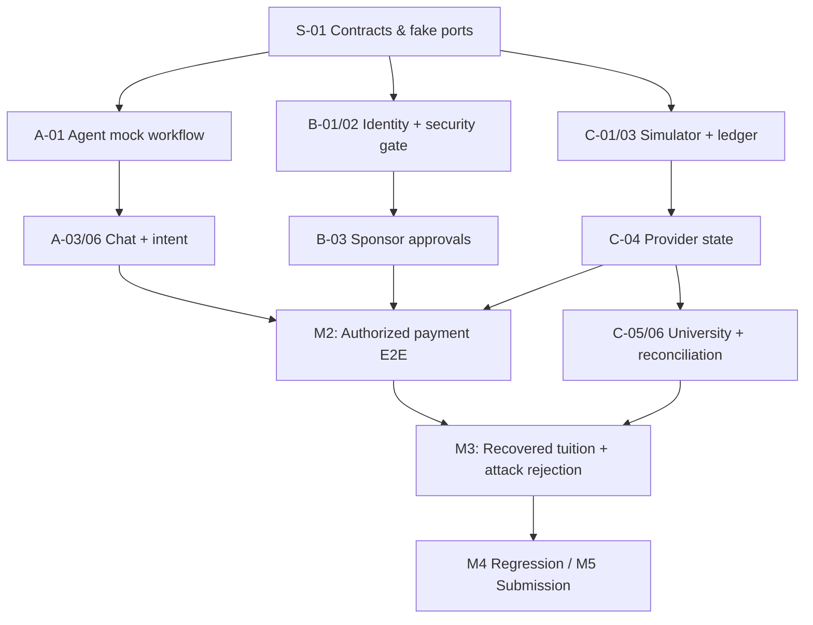
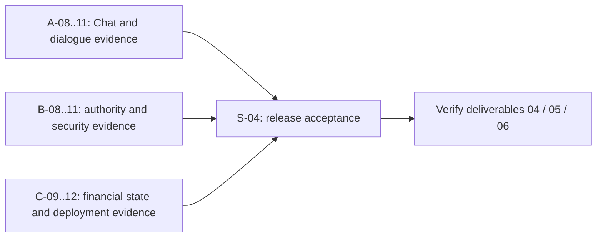

# Rantau — Implementation Roadmap & Tickets

> **Version:** 1.1 — 19 October 2026; original implementation plan retained, scenario/UX refinement added in section 12.
> **Deadline:** 20 October 2026, 23:59 Beijing time = **22:59 WIB**  
> **Team:** 3 developers, full time until deadline  
> **Source of truth:** `docs/product-spec.md` (product scope and detailed domain semantics).
> **Name:** Rantau (confirmed by the team).  
> **Geography:** Indonesia → mainland China primary simulation; Southeast Asia → China architecture extensible.  
> **Non-negotiable:** All payments, university records, quotes, policies, and identities in the demo are **synthetic**. No claimed access to live bank or Chinese university APIs.

**How to use this roadmap:** Sections 1–11 are Phase 1 (implementation); section 12 is Phase 2 (scenario acceptance, UX refinement and submission). After completing your Phase 1 implementation responsibilities and available checks, continue with your Phase 2 tickets without waiting for every other owner. Carry unresolved prerequisites into your progress file; do not declare the whole earlier phase complete or waive acceptance gaps. Once all Phase 1 items are complete, Phase 2 is the default next work. See [AGENTS.md section 8](../AGENTS.md#8-roadmap-progression-and-scenario-refinement).

## 1. Delivery objective

By the competition submission, demonstrate **one complete, replayable, instrumented financial mission**:

1. Authenticated student asks an agent to pay a fictional Chinese university tuition obligation in CNY, using an IDR sponsor-owned account.
2. Agent retrieves obligation, trusted beneficiary, synthetic provider quote and institution policy; shows full landed cost.
3. Student requests payment; sponsor approves exact immutable terms in a separate authenticated dashboard.
4. Protected executor verifies funding ownership, recipient trust, approval, risk, limits and quote validity **inside the execution transaction**; simulated payment debits **once**.
5. Provider reports `DELIVERED`, but the university obligation remains `UNPAID`/`EXCEPTION` because the student reference is missing.
6. Agent investigates evidence, creates/submits a case; separate simulated university service checks evidence, posts tuition **once**, and updates obligation to `PAID`.
7. In a second scripted branch, a malicious invoice/email directs the agent to change the university beneficiary. The backend **holds** the action; no payment is made to the wrong beneficiary.
8. Student and sponsor see only the status and evidence they are authorized to view; audit results can be inspected on the demo page.

**First complete happy-path gate:** student request → approved transfer → correct provider state by **18 Oct**.  
**First full differentiated hero demo:** approved transfer → delivered-but-unposted → reconciliation → verified tuition credit by **19 Oct**.

### P0 / P1 / P2 meanings

- **P0 (must ship):** Without this, the core 40% completion or 30% security story is compromised.
- **P1 (important):** Include once the hero flow works; supports three exception types and interaction breadth.
- **P2 (cut first):** Regional breadth, UI polish, extra educational KB, advanced automation. Not part of mandatory launch gate.

**Never cut:** owner-bound approval, policy gate on every mutation, immutable intent terms, idempotency, provider/university state separation, one real simulated reconciliation result, or attack blocking.

## 2. Ownership boundaries

| Owner | Files/modules exclusively owned | Feature responsibilities | UI surfaces |
|---|---|---|---|
| **Dev A — Agent & Knowledge** | `backend/agent/`, `backend/kb/`, `frontend/app/student/chat/`; can own student *read-only* status panel in chat | LangGraph orchestration, typed tool adapters, dialog, pause/resume, knowledge with provenance, exception triage, bilingual outputs | `/student/chat` |
| **Dev B — Security & Authority** | `backend/authz/`, `backend/approvals/`, `backend/fraud/`, `frontend/app/sponsor/` | Authenticated identity/scope, sponsor mandate, T0–T3 gate, terms-hash approvals, fraud rules/LLM assessment, holds | `/sponsor/approvals` |
| **Dev C — Financial Simulator** | `backend/finance/`, `backend/university/`, `backend/demo/`, migrations/seeds, `frontend/app/student/payments/`, `frontend/app/demo/` | Quotes, payment intents and ledger, provider outcomes, university postings, reconciliations, simulation reset and fixture injection | `/student/payments`, `/demo` |

**Shared files:** `backend/contracts/`, `frontend/lib/api-contracts/`, `backend/main.py`, root config and DB migrations. One assigned reviewer owns merges to each shared file; no uncoordinated interface changes. Prefer generated TypeScript models from a frozen OpenAPI schema rather than hand-copying API definitions.

**Proposed lightweight technology:** Python/FastAPI + LangGraph, PostgreSQL, Next.js. One backend process, one frontend, one DB; **no microservices**. Deploy to any suitable existing platform, with Docker Compose as a predictable local fallback.

## 3. Day-zero shared contract (16 Oct: timebox 90–120 minutes)

All three attend; **A leads contract drafting, B signs off security semantics, C signs off data/state semantics**.

Freeze and commit:

- **Fixture aliases:** `stu_001`, `par_001`, `acct_idr_01`, `uni_cn_01`, `obl_2026_demo_01`, `benef_uni_cn_01`, `quote_001`, plus test-scenario IDs.
- **Typed Pydantic models:** `ActorContext`, `Money`, `FxQuote`, `TuitionObligation`, `PaymentIntent`, `Approval`, `PolicyDecision`, `PaymentResult`, `ReconciliationCase`, `ToolResponse`, `DomainError`.
- **Financial semantics:** integer minor units, currencies IDR/CNY, immutable `terms_hash`, idempotency keys, actor from authenticated session not request body, university posting separate from provider delivery.
- **Ports:** `AuthorizationPort.evaluate(actor, action)`, `PaymentPort.execute(intent_id, key, actor)`, `PaymentPort.status(id, actor)`, `UniversityPort.obligation(id, actor)`, `UniversityPort.reconcile(case_id, actor)`.
- **Common errors:** `FUNDING_OWNER_APPROVAL_REQUIRED`, `BENEFICIARY_MISMATCH`, `APPROVAL_TERMS_MISMATCH`, `QUOTE_EXPIRED`, `PROVIDER_OUTCOME_UNKNOWN`, `SECURITY_HOLD`, `POSTING_WINDOW_ACTIVE`, etc.
- **HTTP prefixes:** all documented `/api/v1/...` endpoints from the MVP spec, with minimum request/response shape frozen.
- **Shared mocks:** `FakeAuthorizationPort` to unblock C; `FakePaymentPort` and `FakeUniversityPort` to unblock A; fake quote/account repositories to unblock B.
- **One clean-start command:** `docker compose up --build` plus `pytest` fixture/contract smoke command, owned by A with C supporting DB.

**Exit gate M0:** A mock-backed student chat can request a payment intent, fake sponsor decision can be queried, and fake executor returns a typed state response; all work in independent branches. This is a contract smoke check, **not** an unsafe bypass in the real executor.

**Change control:** The interface's field names, money units, approval rules, and state transitions cannot change by one developer alone. Agree in team chat, update contract + mock + test, then merge.

## 4. Ticket backlog

Each ticket includes a single owner and binary acceptance checks. `↳` denotes the only required upstream dependency, beyond M0. Estimated effort is a planning guess, not a guarantee.

### Shared kickoff tickets

| Ticket | Owner | Pri | Target | Effort | Depends | Acceptance |
|---|---|---|---|---|---|---|
| **S-01 Contract freeze** | A lead + all review | P0 | Oct 16 | 2h | None | Pydantic objects, enums, ports, HTTP paths, sample payloads, contract tests committed; all approve |
| **S-02 Repo + test/deployment skeleton** | A | P0 | Oct 16 | 2h | S-01 | FastAPI & Next.js boot; DB connectivity stub; pytest runs; lint/test CI available; `.env.example` without secrets |
| **S-03 Seed DB & scenarios** | C | P0 | Oct 17 AM | 3h | S-01 | Postgres schema/migration, isolated demo tenant, deterministic fixtures, reset command and fixture IDs stable |

### Dev A — Agent, knowledge and student chat

| Ticket | Pri | Target | Effort | Depends | Acceptance |
|---|---|---|---|---|---|
| **A-01 Graph / typed tools** | P0 | Oct 17 AM | 3h | S-01 | Graph handles `ASK_POLICY`, `TUITION`, `ALLOWANCE`, `TRACK`, `RECOVER`, `VERIFY_MESSAGE`; calls mocked ports; never directly accesses DB |
| **A-02 University KB + quote explanation** | P0 | Oct 17 | 3h | S-01 | Synthetic `uni_cn_01` rules + cited ZJU reference with `synthetic` and validity flags; quote costs correctly explained, not shown as live FX |
| **A-03 Tuition intent + clarification** | P0 | Oct 17 | 4h | A-01, fake ports | Unambiguous request → quote/payee/intent preview; missing info → only necessary questions; never transfer before approval |
| **A-04 Approval wait/resume** | P0 | Oct 18 AM | 3h | A-03 + B-03 interface | After request agent reports `AWAITING_APPROVAL`; a student-initiated “check/continue” turn reads real server approval then executes via protected tool; fake text approvals rejected |
| **A-05 Recovery investigator** | P0 | Oct 18–19 | 4h | A-01 + C-06 interface | Missing-reference evidence → create/submit case → verify ledger state; cannot directly post university ledger; `OUTCOME_UNKNOWN` does not retry blind |
| **A-06 Student chat page** | P0 | Oct 17–18 | 4h | S-01 | Chat, action summary, quote, approval-pending status, error/recovery steps shown from mock API; handles source/actor session properly |
| **A-07 UX, language and fallback tests** | P0 core / P1 polish | Oct 19 | 3h | A-03–A-05 | UX-01..05; English student + Bahasa Indonesia sponsor summaries; unknown policies trigger safe fallback; concise explanations |

**A's independent first-day demo:** Student chat describes a CNY obligation, shows mock IDR→CNY quote, requests sponsor approval, and visibly waits. No real payment code required at this point.

### Dev B — Security, authorization and sponsor UX

| Ticket | Pri | Target | Effort | Depends | Acceptance |
|---|---|---|---|---|---|
| **B-01 Demo authentication + scoped access** | P0 | Oct 17 AM | 3h | S-01 | Student and parent authenticate separately; verified actor derived server-side; student cannot access sponsor-only decisions; consent controls data visibility |
| **B-02 Policy gate / T0–T3** | P0 | Oct 17 | 5h | B-01 + fake account repo | Hard checks for owner, beneficiary, limits, balances, expired quote, holds, mandate, current state; returns `ALLOW/REQUIRE_APPROVAL/HOLD/DENY` + reason; never trusts LLM classifier for permission |
| **B-03 Bound approvals and mandates** | P0 | Oct 17–18 | 4h | B-01–B-02 | Authenticated owner approves exact `terms_hash`; change invalidates; expiry and single-use enforced; allowance mandates cumulative including reservations |
| **B-04 Sponsor approval dashboard** | P0 | Oct 18 | 3h | B-03 contract | Parent sees authorized transaction amount/currency/payee/cost, approves or rejects via protected UI; text pasted into student chat is not approval |
| **B-05 Fraud hard rules + LLM assessment** | P0 minimal hybrid / P1 tuning | Oct 18–19 | 4h | B-02 + KB adapter | Changed or unverified beneficiary always held; semantic classifier returns advisory indicators only; valid known payee remains usable after compliant authorization |
| **B-06 Holds, audit and security cases** | P0 essentials / P1 case UX | Oct 18–19 | 3h | B-02 | Agent can place hold but cannot clear it; audit has actor/decision/reason and redacts secrets; unrelated actors cannot see each other's case |
| **B-07 Security regression suite** | P0 | Oct 19 | 4h | B-02–B-06 | SEC-01..09 checks database effects, not chat wording; key no-debit, forged approval, prompt-injection and changed terms tests pass |

**B's independent first-day demo:** In two separate authenticated sessions, a student requests a sponsor-funded tuition transfer and the sponsor approves immutable terms. A forged pasted approval is rejected. Uses fake finance backend.

### Dev C — Payment, university simulator and status/demo

| Ticket | Pri | Target | Effort | Depends | Acceptance |
|---|---|---|---|---|---|
| **C-01 Database migrations + fixture reset** | P0 | Oct 17 AM | 3h | S-01 | Repeatable seed with accounts, obligation, beneficiary, two synthetic quotes, scenario flags; no live account identifiers |
| **C-02 Obligation, trusted beneficiary, FX quotes** | P0 | Oct 17 | 3h | C-01 | `GET` endpoints return authorized CNY balance, masked verified recipient, IDR→CNY quote math, quote expiry and provenance |
| **C-03 Payment intents + ledger executor** | P0 | Oct 17–18 | 7h | C-01 + B-02 interface | Create intent, immutable terms; `execute` invokes real gate inside protected transaction; one debit per idempotency key; no overdraw; audit exists |
| **C-04 Provider state / timeout / duplicate control** | P0 core / P1 fault inject | Oct 18 | 3h | C-03 | `PROCESSING→DELIVERED`, `FAILED`, `OUTCOME_UNKNOWN`; retry checks original reference, no duplicate debit or unearned `FAILED` |
| **C-05 University obligation + posting service** | P0 | Oct 18 | 3h | C-01 | Provider `DELIVERED` does not imply tuition `PAID`; privileged simulated university service posts ledger once and verifies account balance |
| **C-06 Reconciliation cases / all three exceptions** | P0 basic branches / P1 advanced automation | Oct 18–19 | 5h | C-04–C-05 | Missing reference → verified posting after authorized case; delayed posting → `AWAITING_POSTING` without duplicate; shortfall → exact difference and policy-gated top-up proposal or escalation. All three basic branches implemented |
| **C-07 Payment status + demo pages** | P0 minimum / P1 polish | Oct 19 | 3h | C-02–C-06 endpoint contracts | `/student/payments` shows provider vs university state; `/demo` resets fixtures, injects expected scenarios and views redacted audit |
| **C-08 Financial tests and concurrency** | P0 | Oct 19 | 4h | C-03–C-06 | TC-01..10; at-most-one debit/post, no negative balance and no duplicate after concurrent retries |

**C's independent first-day demo:** Send a synthetic payment to a verified beneficiary through a fake gate and see distinct provider settlement and institution posting states. Fake gate is isolated and replaced before integrated submission.

## 5. Integration checkpoints and chronology

| Time (WIB) | Milestone | Required evidence | Decision |
|---|---|---|---|
| **Thu, Oct 16 — tonight** | **M0: Interface freeze** | Contract build, fake adapters, seed IDs, branches assigned | No feature coding against incompatible schemas |
| **Fri, Oct 17 — afternoon** | **M1: Independent demos** | A mock chat, B authenticated sponsor approval, C fake-gated ledger all run | Fix contract mismatches immediately |
| **Sat, Oct 18 — by evening** | **M2: First vertical slice** | Student request → sponsor approval → policy-gated simulated debit → status visible; confirmed one debit | Stop ancillary features until this is green |
| **Sun, Oct 19 — afternoon** | **M3: Differentiation and attacks** | Missing-reference correction reaches university `PAID`; fake beneficiary attack gets HOLD; repeated payment no duplicate | Prioritize failing P0 tests |
| **Sun, Oct 19 — evening** | **Feature freeze** | All P0 code integrated, regression script, synthetic status banner | No new KB/countries/scam features |
| **Mon, Oct 20 — morning/afternoon** | **M4: Demo stable** | Fresh reset → hero test → attack test → audit output, deployed endpoint, demo recording | Bug fixes and evidence only |
| **Mon, Oct 20 — target submit by 19:00 WIB** | **M5: Submission** | Final artifact/video/report/link uploaded and verified | ~4h buffer to official **22:59 WIB** cutoff |

**Daily integration discipline:** 15-minute stand-up; 15-minute contract check after lunch; end-of-day smoke demo. Merge short PRs rather than waiting for massive feature branches. Use environment fixtures to ensure no developer requires another's unfinished module. Keep `main` green.

## 6. Minimal dependency graph



**Anti-blocking tactics:**

- A talks to `FakePaymentPort` until actual provider endpoints are ready; B talks to mock balances/accounts; C talks to `FakeAuthorizationPort` until B's gate is ready.
- **Never ship the fake gate** in integrated execution. Add a runtime/integration assertion rejecting fallback stub gate in non-test environment.
- A does not rely on asynchronous push notifications for sponsor approval initially. The verified approval persists server-side; the student says “check payment” or clicks *Continue*, and the agent reloads state. Automatic resume is P2.
- Do not let the LLM generate DB writes, authenticated sponsor decisions, or university posting calls.
- Keep one fixture for the core demo, with extra fixture permutations rather than extra external integrations.
- For demo UI work, use mocks from M0, not hand-coded responses or fixture-specific business shortcuts.

## 7. Test-to-ticket traceability

| Test group | Main owner | Ticket(s) | Go/no-go critical |
|---|---|---|---|
| `TC-01`–`TC-02` obligation/quotes | C + A explanation | C-02, A-02/03 | Yes |
| `TC-03` sponsor-approved tuition | B/C/A | B-02/03/04, C-03, A-04 | **Yes** |
| `TC-04` student-owned payment | B/C | B-01/02, C-03 | Yes |
| `TC-05` allowance mandate | B/C | B-03, C-03 | Yes if living allowance shown |
| `TC-06`–`TC-07` duplicate/timeout | C | C-03/04/08 | **Yes** |
| `TC-08` missing-reference reconciliation | C + A | C-05/06, A-05 | **Yes** |
| `TC-09` delayed posting | C + A | C-05/06, A-05 | **P0 minimal branch**; no false-paid result |
| `TC-10` shortfall | C + A + B | C-06, A-05, B-02 | **P0 minimal branch**; no unapproved top-up |
| `SEC-01`–`SEC-03` role/approval/limit | B | B-01/02/03/07 | **Yes** |
| `SEC-04`–`SEC-05` injection/payee | B + A | B-05/07, A-01/05 | **Yes** |
| `SEC-06`–`SEC-08` leakage/hold/terms | B | B-01/02/03/06/07 | **Yes** |
| `SEC-09` valid payment still possible | B + C | B-05, C-03 | Yes |
| `UX-01`–`UX-05` dialog/fallback | A | A-03/04/05/07 | P1 breadth; at least clarification + safe fallback P0 |

**Automated assertion priority** (in this order): zero unauthorized debit → exactly-once debit → approval ownership → university posting not inferred from provider status → recovery once → correct fallback. Test end state **and** forbidden intermediate effects; an unauthorized debit later reversed is still failure.

## 8. Release readiness checklists

### Must pass for live demo

- [ ] Fresh clean-start works without manually editing DB rows.
- [ ] Two distinct verified demo sessions: student and sponsor; roles cannot be changed by chat.
- [ ] Agent shows synthetic IDR→CNY quote with explicit cost/fee estimate and approved beneficiary.
- [ ] Parent approval is server-recorded and bound to amount/payee/quote/terms hash.
- [ ] Real protected executor and gate are active (no fake security bypass).
- [ ] Exactly one debit appears in ledger, with idempotent duplicate retry.
- [ ] Provider delivered is visibly different from university posting.
- [ ] Missing-reference case finds evidence; privileged simulator posts exactly once.
- [ ] Fraudulent beneficiary change holds and creates **zero** unauthorized debit.
- [ ] Safe error/fallback for provider unknown and missing policy; no invented success.
- [ ] Audit output is redacted, and student/sponsor only see authorized data.
- [ ] Demo recorded on the deployed build; code, video and report match same state.

### If behind schedule, cut in this order

1. P2: extra countries/currencies beyond the required primary IDR→CNY corridor.
2. P2: decorative UI and rich charts.
3. P2: background automatic resumption and outbound notifications.
4. P1: broad educational KB (visa, tax, credit building) and multi-university support.
5. P1: sophisticated scam scoring/model tuning (keep hard payee/auth rules and one safe LLM classification case).
6. P1: elaborate secondary exception UI or fully automated top-up. **Keep both P0 basic branches:** delayed posting yields `AWAITING_POSTING` and a recheck; shortfall yields an exact discrepancy with a permitted next action or escalation. Keep the polished hero demo focused on missing-reference recovery.

**Do not cut to meet schedule:** the security gate, sponsor identity separation, one approved transfer, idempotency, and one verified exception-resolution pathway.

## 9. Integration and failure-response protocol

- Branch pattern: `feat/a-agent-*`, `feat/b-security-*`, `feat/c-finance-*`, `fix/integration-*`.
- Every PR: mention ticket ID, changed contract fields (if any), test commands, demo screenshot/JSON, and security implications.
- Contract break: stop merge, make tiny 3-person decision, update shared models/mocks/test, then resume. Don't silently patch each consumer.
- If an endpoint is late: retain typed stub and continue module tests; do not fake a real financial success in final integrated demo.
- If provider error is ambiguous: mark `OUTCOME_UNKNOWN`; query original provider reference before any retry.
- If a case cannot be posted: end at `ESCALATED` with case ID and explanation, never fabricate `PAID`.
- If a security test fails: block release of payment features until negative-state assertions pass.

## 10. Demo, report and final submission allocation

- **Dev A:** write the 3-minute demo dialogue and agent decision trace, source citations, screenshot of clarification and recovery.
- **Dev B:** assemble the attack script, show protected policy responses, approval proof and security audit.
- **Dev C:** seed/replay final demo fixture, provide ledger/tuition verification screenshots, deploy/reset and capture status screens.
- **All three:** run the hero story once from scratch, then run attack branch independently, then verify upload and links. Final submitted materials must say **simulated** wherever relevant.

## 11. Recommended immediate starting sequence

1. Hold the M0 contract freeze and assign final ownership of shared files **tonight**.
2. Dev A scaffolds FastAPI/Next.js/LangGraph mock agent and generates example run envelopes.
3. Dev B implements immutable approvals and a pure deterministic policy function against stub account records.
4. Dev C builds Postgres migrations plus seeded obligations/accounts and the protected executor against a fake gate.
5. Merge the earliest vertical-slice pieces by 18 Oct; then implement recovery and adversarial paths.

---

*Source basis:* The approved `docs/product-spec.md` (v1.0); excludes real remittance provider integrations and real Chinese university API access. Estimates and milestone dates are execution recommendations, not claims from external sources.

## 12. Phase 2 — Scenario acceptance, UX refinement and submission

### 12.1 Objective, baseline and scope

Turn the implemented MVP into a smooth, independently replayable experience with evidence for all **24 specification scenarios**, three additional Chat checks and deliverables **04–06**. Refine the current interface; the separate Paper redesign is paused.

This is a three-owner compound work plan, authorized on **19 October 2026**. Baseline: main `69950e5` (PR #32). Existing merged code and historical tests are starting evidence, not final acceptance. The [scenario checklist](scenario-checklist.md) contains the executable steps and currently unchecked final acceptance records. UX-02 explicitly has limited free-form editing; discovering or fixing missing acceptance behavior is part of this phase.

**In scope:** scenario-specific fixes, natural concise replies, essential clarification, accurate financial states, clear next actions, English student/Bahasa Indonesia sponsor summaries, responsive/accessible interactions, reproducible resets and redacted evidence. Each ticket includes its own checks and documentation.

**Scope boundary:** preserve the approved simulator, current ownership and deterministic security gates. Do not add real banking connections, more countries, a new design system, transcript restoration, new agent financial powers or model-authored financial replies as incidental polish. No new endpoint, migration, enum or policy is authorized by this roadmap. Agree any necessary shared change under AGENTS.md section 3; keep unaffected work moving.

**Working surfaces** (existing files/directories; modify only when the ticket needs it):

```text
docs/roadmap.md                [MODIFIED] Phase 1 retained; Phase 2 scope/acceptance
AGENTS.md                      [MODIFIED] Progression and execution workflow
docs/product-spec.md           [UNCHANGED] Product/security authority
backend/agent/, backend/kb/    [EXISTING] A-owned dialogue/tools
backend/authz/, approvals/, fraud/ [EXISTING under backend/] B-owned authority
backend/finance/, university/, demo/ [EXISTING under backend/] C-owned outcomes
frontend/app/student/chat/    [EXISTING] A-owned Chat
frontend/app/sponsor/         [EXISTING] B-owned approval UX
frontend/app/student/payments/, frontend/app/demo/ [EXISTING] C-owned status/demo
tests/, frontend/tests/       [EXISTING] Relevant regressions accompany fixes
docs/scenario-checklist.md    [EXISTING] Per-scenario results and evidence
docs/progress/progress-a.md   [EXISTING] A execution/review/gaps
docs/progress/progress-b.md   [EXISTING] B execution/review/gaps
docs/progress/progress-c.md   [EXISTING] C execution/review/gaps
README.md                     [EXISTING] Reproducible setup/deployment/reset
```

### 12.2 Parallel execution and dependency rules

- **Start independently:** each owner takes the first runnable ticket in their lane from current main. Do not introduce an all-team kickoff, new contract freeze or completion of all earlier checkboxes as a prerequisite. An unchecked final acceptance box is the work to do, not a reason to wait.
- **First pass:** spend about 30–60 minutes on one scenario or a closely related group, then record findings and a minimal fix. This is a review checkpoint, not a promise of completion or a maximum debugging time. Prioritize unsafe behavior, broken flow and misleading state before visual detail.
- **Isolate environments:** use separate development/test databases per owner and independent student/sponsor/admin browser contexts. Never reset another owner's running scenario. Automated destructive tests use disposable test databases, not the app database.
- **No reviewer queue before work:** request one relevant non-author reviewer after a small fix/evidence slice is ready, then continue another independent scenario. Cross-review need not involve all three developers for every case. Financial/security effects require the relevant B/C evidence; reviews and required CI still gate PR merge and final acceptance.
- **Local blockers only:** record scenario, owner, observed error, expected existing interface and next action in your progress file. Continue independent work against stable typed adapters or isolated fixtures; label it provisional. Never substitute a fake gate or claim a mock-backed run proves integrated success.
- **Keep shared edits small:** the scenario lead owns outcome/evidence, not permission to rewrite another owner's module. Ask the module owner for a focused fix. Update only your task row and the scenario you own; avoid reformatting shared documents. Agree shared-interface/security changes before implementation.
- **No serial ticket chain:** all tickets below can start with the current implementation. Evidence packaging can begin before acceptance is complete. Only final release sign-off waits for required scenarios, independent review and the chosen release checks. Continue the existing local-commit default; push/PR/merge remain separately authorized and governed by AGENTS.md.

### 12.3 Dev A — Conversation and student interaction

| Ticket | Pri | First pass | Start / dependency | Acceptance and review |
|---|---|---|---|---|
| **A-08 Tuition planning journey** | P0 | 30–60m | Start now; existing A-02/03 and C reads | Lead TC-01, TC-02 and UX-01. Ask only missing essentials; remember selections; explain exact balance/deadline, comparable total cost/fee/expiry and next step. Run connected Chat with actual model plus state assertions; C reviews numbers. Update own progress and owned checklist results. |
| **A-09 Safe revision journey** | P0 acceptance gap | 30–60m | Start now; existing revision/approval boundaries | Lead UX-02. Test supported route/funding changes and unsupported amount/recipient requests before and after approval. Revised summary and Payments handoff must be clear; never continue a stale approved draft. Close the documented editing gap within agreed scope, or record LIMITED and seek explicit scope acceptance; refusal alone is not full feature completion. B reviews approval integrity; C checks revisions. |
| **A-10 Conversation quality and fallback** | P0 correctness / P1 polish | 30–60m per group | Start now; no new API needed | Lead UX-03, UX-05 and CHAT-01–03. Natural greeting/help/unrelated-request handling, task return without stale cards, truthful cited policy fallback, readable amounts/paragraphs, scrolling/reset/privacy and mobile usability. Verify English student and existing Indonesian sponsor summary with B; no new authority from language/search. Exercise a paraphrase and an error path; preserve the persistent sandbox notice without repetitive reply disclaimers. |
| **A-11 Judge-facing agent journey** | P0 evidence | 30–60m rehearsal | Draft now from current Chat; final capture needs a passing hero release | Own deliverable 06 dialogue, Chat screenshots and redacted agent-run/tool trace. Show actual-model interpretation and controlled tool execution honestly; command turns may bypass the model and replies may be templates. Rehearse TC-03 → TC-08 with B/C contributions. A non-author follows the script without coaching; final capture identifies model/build and matches domain records. |

**A's first runnable slice:** TC-01 → TC-02 → UX-01, then review the student-facing TC-03/TC-08 dialogue while B/C validate their own effects. A-09 can be investigated independently while any cross-owner fix is pending.

### 12.4 Dev B — Approval, security and sponsor interaction

| Ticket | Pri | First pass | Start / dependency | Acceptance and review |
|---|---|---|---|---|
| **B-08 Owner approval and mandate journey** | P0 | 30–60m per group | Start now; existing authority and finance services | Lead TC-03 and TC-05. Verify separate authenticated owner decision, exact terms, principal/fee/total/recipient/expiry, reject/expired states, cumulative mandate reservations and one permitted debit. Sponsor EN/ID controls remain understandable and never approve on language change. C reviews SQL effects; A reviews handoff/return to Chat. Record service/HTTP versus real browser evidence accurately; do not invent an agent allowance planner. |
| **B-09 Identity and privacy attack journey** | P0 | 30–60m | Start now; existing scoped sessions/reads | Lead SEC-01, SEC-02 and SEC-06. Claimed role, pasted approval and unrelated-account requests cannot change authority or disclose private data. Explain the refusal and a valid next step without echoing secrets. A reviews Chat behavior; retain stored authorization and no-debit evidence. |
| **B-10 Holds, limits and valid-payment control** | P0 | 30–60m per group | Start now; existing hard rules and protected executor | Lead SEC-03, SEC-04, SEC-05, SEC-07, SEC-08 and SEC-09. Verify cumulative limits, untrusted invoice isolation, trusted-recipient enforcement, reviewer-only hold clearing and changed-term invalidation. Show a clear hold reason/next step and a separately reset valid-payment control. C reviews forbidden effects/one valid debit; A reviews agent explanation. No blanket success claim from assistant wording. |
| **B-11 Security assessment and attack evidence** | P0 evidence | 30–60m first draft | Draft now from existing controls; final results follow owned cases | Own deliverable 05 and deliverable 06 approval/attack proof. Explain T0–T3, enforcement points, evidence levels and known limits; correlate exact-terms approval/hold with financial effects. A/C supply their existing evidence; one non-author reviews the report for unsupported claims. Keep an independent attack reset and zero unauthorized debit; do not block other work while assembling the report. |

**B's first runnable slice:** TC-03 owner approval and SEC-01/02, then SEC-04/05/07 and the SEC-09 valid control. Other security checks continue in parallel with C's recovery work.

### 12.5 Dev C — Financial outcomes and environment clarity

| Ticket | Pri | First pass | Start / dependency | Acceptance and review |
|---|---|---|---|---|
| **C-09 Payment execution and uncertain outcomes** | P0 | 30–60m per group | Start now; existing stored authority/provider simulator | Lead TC-04, TC-06, TC-07 and UX-04. Student-owned funding uses its actual approval path. Duplicate/concurrent requests have one debit effect; timeout checks the original reference; authoritative failure/reversal is explained honestly. Verify balance, reservation/spending, transfer and ledger state; B reviews authorization and A reviews user feedback. Preserve zero unauthorized effects and no automatic blind retry. |
| **C-10 Recovery and tuition completion** | P0 | 30–60m per group | Start now; existing A-05/C-06 paths | Lead TC-08, TC-09 and TC-10. Missing-reference submission leads to independent university review and one linked posting; delayed posting stays pending; shortfall is exact with permitted Payments handoff or escalation. Listing/selecting a payment does not submit or debit. A reviews conversation/next step; B reviews protected top-up/review authority. Save before/after records, not only screenshots. |
| **C-11 Explain the finance environment** | P0 clarity / P1 extra presentation | 30–60m | Start now with existing authorized reads/pages; no new endpoint prerequisite | Refine Payments and Demo using section 12.8: visible fixture/run, request/approval/transfer/posting/case states, exact money and safe next actor. Preserve all controls, simulation labels and independent university authority. Student views exclude sponsor balances. Use existing audit/authorized inspection for judge evidence; a new aggregate API needs separate agreement. A reviews understandability; B reviews visibility/redaction. Include a missing/uncertain-record regression. |
| **C-12 Reproducible source and release environment** | P0 evidence | 30–60m first rehearsal | Start now; existing README/reset/deployment | Own deliverable 04: repository/release reference, sanitized config/locks/migrations, clean setup/deployment/reset and executable test instructions. Rehearse a clean start without manual row edits; capture versions/build URLs and scoped baseline. Verify the current candidate independently of other owners' fixtures. Prepare ledger/posting evidence for deliverable 06; each owner verifies their own code/tests. Final build checks are section 12.10. |

**C's first runnable slice:** TC-08 and its reset/posting proof, then TC-07/TC-06. C-11 can improve existing labels/state layout while any recovery review is pending; C-12 setup can be rehearsed before the final release exists.

### 12.6 Scenario ownership — one acceptance lead per case

Module ownership from section 2 is unchanged. The reviewer column describes cross-checks, not permission to change another owner's code. Record each case separately even when one command exercises several cases.

| Scenario IDs | Acceptance lead | Phase 2 ticket | Cross-check |
|---|---|---|---|
| TC-01, TC-02, UX-01 | A | A-08 | C: amounts, quotes and records |
| UX-02 | A | A-09 | B: stale approval; C: revision state |
| UX-03, UX-05, CHAT-01, CHAT-02, CHAT-03 | A | A-10 | B: language/privacy; C: financial claims where affected |
| TC-03, TC-05 | B | B-08 | C: approval/debit/limits; A: user handoff |
| SEC-01, SEC-02, SEC-06 | B | B-09 | A: replies; C: financial effects where applicable |
| SEC-03, SEC-04, SEC-05, SEC-07, SEC-08, SEC-09 | B | B-10 | C: limits/debits; A: tool/refusal behavior |
| TC-04, TC-06, TC-07, UX-04 | C | C-09 | B: authority; A: outcome explanation |
| TC-08, TC-09, TC-10 | C | C-10 | A: investigation/recovery; B: protected actions |

### 12.7 Review cycle and scenario exit criteria

1. **Reset and baseline:** use the checklist's documented setup on an isolated app database. Record scenario/run, commit, model if used, tester, initial balances and linked tuition state; keep student/sponsor/admin sessions separate.
2. **Run the user's journey:** follow the checklist through the real integrated services. Use actual OpenRouter for model-dependent Chat turns; keep deterministic command turns distinct. Add one natural paraphrase or likely error/retry to an agent scenario. Service-only scenarios keep their actual evidence level; they do not need a fabricated Chat feature.
3. **Inspect correctness and UX:** required information is available without coaching; ask only missing essentials; amounts/expiry/status agree across views; every pending/held/error state explains reason and next actor/action. Verify keyboard/focus, readable spacing, long replies, mobile width and usable scrolling for affected screens. No new design-system dependency.
4. **Assert effects:** correlate the actual session/run/intent/transfer/case/posting. Verify both expected effects and forbidden intermediate effects, including zero unauthorized debit and no duplicate debit/posting. A later reversal does not excuse an unauthorized debit.
5. **Fix and regress:** the module owner makes the smallest justified change, adds/updates a meaningful regression for a discovered defect, runs affected checks and updates their progress row. Preserve exact terms, scoped reads, unknown-outcome checks and independent posting. PR review follows the normal workflow; continue other ready work while it is pending.
6. **Independent replay:** one relevant non-author replays or inspects the reproducible evidence at its declared level, records reviewer/result, and calls out remaining friction. Iterate on failing assertions or material UX issues. Extra cosmetic passes can be deferred; correctness cannot.
7. **Record separately:** progress tracks implementation/checks/review; the checklist tracks final scenario acceptance. Save actual result, commands, timestamp, commit, evidence level and redacted references. PASS requires all scenario assertions and required review/evidence; FAIL/BLOCKED/LIMITED stays unchecked. Historical automation is not a fresh actual-model browser result.

**Known gap rule:** UX-02 is not completed by safely refusing unsupported edits. Implement the approved behavior or obtain an explicit product/spec acceptance of narrower behavior, preserving the recorded limitation. Likewise, a Payments handoff for top-up and service-level allowance evidence must not be described as agent orchestration. Missing model credentials block only actual-model evidence; continue offline regressions and other tickets while leaving that evidence pending.

### 12.8 Finance clarity and judge-facing evidence

Use a consistent explanation across existing surfaces:

**Request → owner approval → payer debit → provider delivery → university credit**, with a reconciliation branch when matching is needed. These are separate records, not one inferred success state. Only mark stages reached when authoritative current data proves them; unknown/unavailable data stays explicit.

| Surface / owner | Required clarity | Boundary |
|---|---|---|
| Chat / A | User intent, selected tuition/funding/route, concise explanation, current status and next safe action; link to existing Payments when appropriate | Do not duplicate every record in each reply or expose sponsor balances; detail reads cannot execute |
| Sponsor / B | Who requests what, funding ownership, recipient, principal/fee/total, expiry, explicit approve/reject and the recorded result | Separate verified session; changing language or viewing a request never grants approval |
| Payments / C | Payment/provider status beside tuition expected/posted/remaining amounts; current case and actor needed next | DELIVERED is not PAID; a submitted case is not a posting; show scoped backend truth |
| Demo / C | Selected synthetic scenario/run, control versus observed outcome, existing redacted audit, before/after financial proof | Admin only; clock/reset/review controls are simulator actions, never agent powers or user payment buttons |

Example to explain, then verify against the selected fixture: **IDR 46,000,000 principal + IDR 25,000 fee = IDR 46,025,000 debit; CNY 20,000 delivered; CNY 0 university-posted before reconciliation; one verified CNY 20,000 posting makes remaining tuition zero.** These are example fixture values, not a fresh acceptance result or live FX claim. Show payer balance changes only to the authorized owner or through approved redacted admin evidence.

For the judge, capture model ID/timing and bounded redacted tool/run references alongside B approval/hold and C financial/posting evidence. Do not export raw model context, credentials or hidden reasoning. Explain that actual-model interpretation is connected to protected backend tools; do not imply every command/template reply was generated by the model. The read-only snapshot may be stale, so disclose its checked time and refresh through existing supported paths.

### 12.9 Verification and documentation per slice

The [checklist](scenario-checklist.md) remains the source for per-scenario setup, exact test selectors and expected state. Start with its targeted commands; do not run the whole database suite for every copy/layout adjustment. Depending on touched code, use the applicable owner suite below and existing frontend schema-generation/build prerequisites from README:

```powershell
# A: agent/dialogue and integrated UX; select relevant modules for a small fix.
uv run pytest tests/agent tests/finance/test_agent_ux.py -q --tb=short
# B: existing identity/approval/hold regression coverage.
uv run pytest tests/authz tests/approvals tests/fraud -q --tb=short
# C: existing finance/provider/university/reconciliation coverage.
uv run pytest tests/finance -q --tb=short
# Backend changes: retain typing/lint gates.
uv run mypy
uv run ruff check .
# Frontend changes: build before the configured mock-backend browser suite.
npm --prefix frontend run build
npm --prefix frontend run typecheck
npm --prefix frontend run lint
npm --prefix frontend run test:e2e
```

These automated commands do not themselves establish actual-model browser evidence. Follow the checklist's separate connected-browser steps where required. Use disposable `rantau_test*` databases or its documented temporary cluster setup for SQL tests; never point destructive tests at the app database.

For **each ticket**, update the owner's existing progress row with Desc, exact commands/results, limitations, date and review/publication state. Update only the owned scenario entries with acceptance evidence. Use README for changed setup/controls; no per-ticket Markdown plans/reports. Store local evidence in ignored `.generated/acceptance/` and prepare only reviewed, redacted submission copies outside the Git index. Do not mark another owner's task complete.

### 12.10 Release assembly and final gate

| Ticket | Lead | Can begin | Exit acceptance |
|---|---|---|---|
| **S-04 Final scenario release and submission** | C coordinates; A/B review their evidence | Start the evidence index/rehearsal now; no blocker on drafting 04/05/06 | All 24 scenarios and CHAT-01–03 have individual results and required evidence; any narrower scope is explicitly approved and remains visible, never silently checked off. Required financial/security assertions pass; candidate CI/review passes; clean deployed hero and separate attack replay pass. Deliverables 04–06, code, build, logs and video identify the same release; links/uploads and redaction are independently verified. |



The A/B/C lanes and evidence drafts run in parallel with no cross-lane start dependency. Final acceptance/recording waits for the required linked outcomes, review and release checks; a blocked scenario never stops unrelated refinement. Aim for one uncoached sponsor-funded missing-reference journey first, then an independently reset attack branch, while other scenarios continue in their owner lanes.

Before final sign-off, run the full release checks on the selected commit (README prerequisites apply), preserving the actual results:

```powershell
uv run pytest tests -q --tb=short
uv run mypy
uv run ruff check .
uv run python scripts/check_repo_hygiene.py
docker compose config --quiet
npm --prefix frontend run build
npm --prefix frontend run typecheck
npm --prefix frontend run lint
npm --prefix frontend run test:e2e
```

After a candidate changes, rerun affected scenario acceptance and final release checks; recapture evidence whose behavior/build changed. Use one chosen final release for submitted video/logs and refresh the run record rather than mixing older local results with a new deployed build. Keep the original deadline and submission buffer from section 5; this phase adds no mandatory all-team meetings or new external infrastructure.
