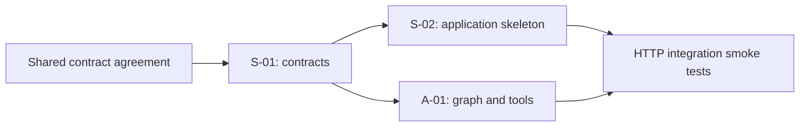

# SPEC: Dev A foundation

## At a Glance

- **Objective:** Establish agreed typed contracts, a reproducible application skeleton, and a LangGraph agent that routes six supported intents through typed mock adapters.
- **In scope:** S-01 contracts and fixtures; S-02 FastAPI/Next.js/PostgreSQL connectivity, CI and hygiene; A-01 graph, OpenAI classifier, offline test classifier, scoped tool adapters.
- **Current state:** The repository contains the approved MVP specification, roadmap and contribution instructions; no application, contracts, tests or hygiene checker exists.
- **Out of scope:** A-02 policy research, A-03 complete payment dialogue, A-04 approval resumption, A-05 full recovery workflow, A-06 chat UI, A-07 language breadth; these retain their roadmap tickets.
- **Scope boundary:** Do not implement B's authentication, approval, fraud or policy engine; C's payment executor, persistent financial ledger, migrations, university posting or scenario service; real financial integrations; or autonomous payment execution.

## Status

- **Implementation:** Not started. The requester approved this contract proposal on 2026-10-16; implementation and checks are pending.
- **Last audit date:** 2026-10-16.
- **Review status:** Approved by the requester for the team on 2026-10-16.
- **Decisions already agreed:** Dev A owns this work; local-first tooling may be selected; OpenAI is the classifier provider and the model must be configurable. Offline tests use a fake classifier.
- **Approved implementation decisions:** IDR scale 0/CNY scale 2; field and port shapes below; fail-closed HTTP integration until actual auth/domain adapters are connected; bounded six-intent classification with a safe clarification path.
- **Key source files:** `AGENTS.md`, `CONTRIBUTING.md`, `Rantau-MVP-Spec.md` sections 1.4, 3-8 and 11-12; `Rantau-3Dev-Roadmap.md` sections 2-4.
- **Known environment limitation:** Docker Compose is installed, but the Docker engine was unavailable during preflight. Database/Compose checks must be reported as unavailable until it runs.
- **Credentials:** No credential value has been inspected. Live OpenAI verification requires a locally configured `OPENAI_API_KEY`; never put it in chat, source, fixtures or logs.

## Folder Tree

All paths below are proposed implementation paths. Existing MVP/roadmap content retains its product scope; branding and source filenames change to Rantau.

```text
rantau/
|-- AGENTS.md, CONTRIBUTING.md, Rantau-*.md [RENAMED - BRANDING ONLY]
|-- README.md                                  [MODIFIED] setup and limitations
|-- .gitignore                                 [NEW] local/generated artifacts
|-- .env.example                               [NEW] sanitized configuration
|-- pyproject.toml, uv.lock                     [NEW] Python dependencies/checks
|-- compose.yaml                               [NEW] three local services
|-- .github/workflows/ci.yml                    [NEW] reproducible checks
|-- scripts/                                   [NEW]
|   |-- check_repo_hygiene.py
|   `-- export_openapi.py
|-- backend/                                   [NEW]
|   |-- __init__.py, main.py, config.py, dependencies.py
|   |-- Dockerfile
|   |-- contracts/
|   |   |-- __init__.py, enums.py, models.py, ports.py
|   |   `-- http.py
|   `-- agent/
|       |-- __init__.py, graph.py, tools.py, classifier.py
|       |-- openai_classifier.py, router.py
|       `-- demo.py                            explicit isolated synthetic run
|-- tests/                                     [NEW]
|   |-- contracts/test_models.py, test_ports.py
|   |-- fixtures/contracts.json, fakes.py
|   |-- test_application.py, test_hygiene.py
|   `-- agent/test_graph.py, test_openai_classifier.py
|-- frontend/                                  [NEW]
|   |-- package.json, package-lock.json, Dockerfile
|   |-- tsconfig.json, next.config.ts, eslint.config.mjs, next-env.d.ts
|   |-- app/layout.tsx, page.tsx, globals.css
|   `-- lib/api-contracts/                     generated locally; ignored
|-- docs/dev-a-foundation.md                    [NEW] setup/examples/check evidence
`-- specs/spec-dev-a-foundation/spec.md         [NEW] this review proposal
```

Generated OpenAPI/TypeScript outputs are reproducible local/build artifacts; commit the exporter and generation command, not ignored build output. Dependency lockfiles are committed. Do not create empty B/C implementation modules.

## Sub-Tasks

| Ticket | Title | Owner | Dependency | Status |
|---|---|---|---|---|
| S-01 | Contract freeze, samples and typed test mocks | A drafts; requester approves for B/C | Approved 2026-10-16 | Implemented; 31 focused checks pass |
| S-02 | Reproducible application and CI skeleton | Dev A | Approved S-01 | Implemented; local checks pass; Docker runtime unavailable |
| A-01 | Six-intent graph and typed tools | Dev A | Approved S-01; S-02 supplies HTTP integration | Not started |

## Dependency Graph



After S-01, scaffolding and graph internals can progress independently; HTTP smoke tests need both. This does not authorize delegated agents. Keep implementation changes identifiable by ticket and use PR review before merging.

## Shared Context and Constraints

- Python 3.12, uv, Pydantic v2, FastAPI, LangGraph, PostgreSQL; Next.js App Router/TypeScript and npm. Resolve compatible dependency versions against official documentation and commit locks.
- Backend checks: pytest, Ruff, mypy. Frontend checks: TypeScript, ESLint and production build. CI generates OpenAPI/types before frontend checks.
- `ActorContext` is internal server data. User messages, extracted identifiers and classifier output are untrusted. A port must recheck resource access; a routing decision grants no permission.
- No mock authorization gate in the integrated app. Fakes reside in test fixtures; an explicit local demo constructs an isolated synthetic tool harness, with no financial DB access or protected HTTP executor.
- Exact money only. Timestamps are timezone-aware UTC. IDs are opaque strings supporting stable fixture aliases; database UUID mapping remains C's responsibility.
- User-facing domain states and errors preserve the MVP vocabulary. Infrastructure errors use separate codes and cannot be mistaken for a financial success.
- Return only selected safe display fields. Never expose raw prompts, chain of thought, SDK exceptions, funding balances, arbitrary tool payloads or bearer/session tokens in run traces.

## Integration Acceptance Criteria

- [ ] Contract samples validate and generated TS agrees with the exported API schema.
- [ ] Backend tests, type checks and lint pass; frontend type checks, lint and build pass.
- [ ] Unauthenticated or unwired application requests cannot invoke any financial action or mock gate.
- [ ] All six intents reach their allowed graph path using fake ports; ambiguity/provider failure calls no financial mutation.
- [ ] An isolated contract smoke flow can create a synthetic intent, request approval and observe a pending response; fake executor behavior is tested independently from HTTP execution.
- [ ] Provider delivery and university posting remain separate in models, tool results and messages.
- [ ] Hygiene checks reject local artifacts/secrets, allow sanitized templates and retain lockfiles.
- [ ] Compose connectivity is verified if Docker becomes available; otherwise the exact unavailable checks are documented.
- [ ] No silent interface changes; all ticket-level acceptance checks below are satisfied before marking those tickets complete.

## Sub-Task Specs

### S-01: Contract freeze and isolated mocks

#### At a Glance

Add the shared versioned Pydantic/HTTP models, Protocol ports, synthetic samples and contract checks required for A/B/C to work independently.

#### Status and Problem Statement

No executable contracts currently exist. The MVP supplies domain vocabulary and minimum HTTP envelopes, but does not freeze every field, unit or integration seam. A drafts these together; requester approval is required before treating this proposal as frozen.

**Key files:** `backend/contracts/{enums,models,ports,http}.py`, `tests/contracts/`, `tests/fixtures/`, `scripts/export_openapi.py`, `docs/dev-a-foundation.md`. Their proposed layout appears in the shared tree above.

**Scope boundary:** Define data and ports, not authorization decisions, real approval records, debit/posting logic or DB schema/migrations.

#### Interface Contract

All models forbid extra fields; money integers reject booleans/floats/coercible strings and fit JavaScript's safe integer range. Nonnegative amounts describe balances/fees; payment amounts must be positive. Cross-field consistency is validated where locally knowable. Models are data contracts, not proof that approval or settlement actually happened.

**Units proposal:** `CURRENCY_SCALE = {"IDR": 0, "CNY": 2}`. `Money = {currency, amount_minor}`. Thus `2000000 CNY` represents CNY 20,000 and `46025000 IDR` represents IDR 46,025,000. Do not change scales after integration without coordinated migration.

| Model | Required shape / semantics |
|---|---|
| `ActorContext` | Internal `actor_id`, `tenant_id`, `session_id`, `role`, `scopes`; no raw token. Role is STUDENT/SPONSOR/UNIVERSITY_SERVICE/DEMO_ADMIN. Never accepted from agent request JSON. |
| `Money` | `currency: IDR\|CNY`, `amount_minor: strict integer`, scale fixed above. |
| `FxQuote` | `id`, provider display alias, source/target country, `source_currency`, `destination_currency`, `source_principal_minor`, `fee_minor`, `source_total_minor`, `destination_amount_minor`, exact decimal-string `rate`, `expires_at`, estimated delivery timestamp, `synthetic: true`. Rate means destination major units per source major unit; explicit rounding must be consistent with integer amounts. |
| `TuitionObligation` | `id`, `student_id`, `university_id`, `currency`, `amount_due_minor`, `posted_minor`, `balance_minor`, `due_at`, `policy_id`, `state`. Balance derives from due minus verified postings, never provider delivery. |
| `TrustedBeneficiary` | `id`, university/student ownership reference, masked display, `fingerprint`, `verified`; never full account identifiers. |
| `UniversityPolicy` | `id`, university/term, version, reference requirements, posting-window duration, partial/top-up flags, provenance URL/date/validity, certainty and `synthetic`; missing/expired policy prevents dependent mutation. No new real institutional claims. |
| `PaymentIntent` | `id`, `intent_revision`, `requested_by`, funding owner/account, beneficiary ID/fingerprint, obligation or allowance purpose, source/target currency, source total/destination minor amounts, quote ID/expiry, policy version, `terms_hash`, tier, `state`. No mutable client approval flag. |
| `Approval` | ID, intent/revision/hash, funding account, beneficiary ID/fingerprint, source/target amounts/currencies, quote ID/expiry, policy version, authenticated approver ID, expiry, approval state and consumed timestamp. B owns verification and recording. |
| `ActionIntent` | Action kind, resource/intent ID and immutable terms reference; no caller-provided authorization verdict. |
| `PolicyDecision` | `decision: ALLOW\|REQUIRE_APPROVAL\|HOLD\|DENY`, tier, reason code, audit event ID. Preview is advisory; protected executor reevaluates. |
| `PaymentResult` | `payment_id`, `intent_id`, provider reference alias, `transfer_status`, redacted receipt reference, audit event ID; does not contain inferred tuition success. |
| `ReconciliationCase` | ID, payment/obligation ID, evidence references, missing-evidence list, case state, audit event ID; submission is not posting approval. |
| `ToolResponse[T]` | Typed success data or `DomainError`; never both success and error. Scope-checked/redacted by adapter. |
| `DomainError` | MVP fields: `status`, `reason_code`, nullable `resource_id`, safe `message`, `retryable`, `next_action`, `audit_event_id`. Preserve `REQUIRES_APPROVAL` as envelope status separately from payment `AWAITING_APPROVAL`. |

Payment, approval, obligation and reconciliation enum members are copied exactly from MVP section 6; do not merge their state machines. `Intent` has exactly `ASK_POLICY`, `TUITION`, `ALLOWANCE`, `TRACK`, `RECOVER`, `VERIFY_MESSAGE`. Clarification is a routing outcome, not a seventh financial intent.

`terms_hash` remains an opaque digest produced by the trusted payment service; these tickets do not define a competing hash algorithm. Synthetic fixture hashes are clearly marked and unusable as real authorizations.

```python
class AuthorizationPort(Protocol):
    async def evaluate(self, actor: ActorContext, action: ActionIntent) -> PolicyDecision: ...


class PaymentPort(Protocol):
    async def execute(
        self, intent_id: str, idempotency_key: str, actor: ActorContext
    ) -> PaymentResult: ...
    async def status(self, payment_id: str, actor: ActorContext) -> PaymentResult: ...


class UniversityPort(Protocol):
    async def obligation(self, obligation_id: str, actor: ActorContext) -> TuitionObligation: ...
    async def reconcile(self, case_id: str, actor: ActorContext) -> ReconciliationCase: ...
```

`UniversityPort.reconcile` means submitting/rechecking an evidence case, never privileged posting. Typed companion read/proposal ports cover quotes, trusted beneficiaries, permission summaries, policy lookup, approval requests and case creation using the same models. No port offered to the graph can record approvals, trust beneficiaries, clear holds, reset fixtures or post university ledger rows.

Freeze the full HTTP inventory from MVP section 8 as a contract catalogue with request/response samples. Only A's routes are implemented by these tickets; B/C own their endpoints. Preserve its envelopes: agent `{run_id,message,requested_action,tool_events,resources}`, intent `{id,terms_hash,tier,state,approval_required,quote_expires_at}`, execution `{payment_id,transfer_status,audit_event_id}`, reconciliation `{case_id,status,evidence_missing}` and sponsor decision `{approval_id,decision,intent_id,current_terms_hash,recorded_at}`.

Agent request proposal: `{message: bounded nonempty string, conversation_id: nullable opaque ID}`. No role, actor, approval, arbitrary tool name or authoritative payment state in the request. Caller-provided IDs are references requiring scoped lookup, never authorization.

#### Expectations

```python
from backend.contracts.models import Money

assert Money(currency="CNY", amount_minor=2_000_000).amount_minor == 2_000_000
# Money(currency="CNY", amount_minor=0.1) raises ValidationError.
```

Two synthetic quote samples use consistent integer arithmetic and explicit expiry. Stable aliases remain `stu_001`, `par_001`, `acct_idr_01`, `uni_cn_01`, `obl_2026_demo_01`, `benef_uni_cn_01`, `quote_001`. Fixtures include approval-required, held, expired-quote, delivered/unposted and provider-unknown responses. Fake authorization is importable only by the isolated test harness, never a fallback application dependency.

#### Test Scenarios

| Case | Given / when | Required assertion |
|---|---|---|
| S1 | All success/error/HTTP examples load | Every sample validates; round-trip JSON preserves exact money and states. |
| S2 | Fractional, bool, negative or unsafe-size money | Validation rejects it; currencies and quote totals are consistent. |
| S3 edge | Naive expiry, expired policy, unknown enum or contradictory success/error | Reject invalid shape; expired data stays unusable for mutation. |
| S4 security | Chat payload contains `role` or approval field | Request validation rejects authoritative extra fields. |
| S5 regression | Provider says DELIVERED; university posted zero | Obligation is not PAID; no derived posting. |
| S6 | Fake contract intent/approval/executor sequence | Typed AWAITING_APPROVAL/held result without fabricating sponsor consent or actual DB effects. |

#### How to Test

```powershell
uv run pytest tests/contracts -v
uv run mypy backend/contracts --strict
uv run ruff check backend/contracts tests/contracts
uv run python -m scripts.export_openapi
```

Commands become runnable when S-02's package configuration is available; for isolated S-01 checks, use an explicitly configured temporary environment with the same locked package requirements, without committing environment output.

#### Acceptance Criteria and Documentation Checklist

- [ ] All S1-S6 scenarios, type checks and lint pass; full suite has no new failures.
- [ ] Requester approves exact units, model fields, HTTP catalogue and port semantics for the team; no silent interface changes.
- [ ] Samples and mocks use identical shared types; exporter supports TS generation.
- [ ] Document catalogue, errors, fixtures, unit mapping and pending B/C integration in `docs/dev-a-foundation.md`.

### S-02: Application and deployment skeleton

#### At a Glance, Status and Problem Statement

Add a bootable FastAPI/Next.js/PostgreSQL development setup and reproducible checks. Implementation is not started; it depends on S-01 approval. No app setup currently exists.

**Key files:** root tooling/config/lockfiles, `.env.example`, `compose.yaml`, `backend/{main,config,dependencies}.py`, Dockerfiles, `frontend/`, `scripts/`, `.github/workflows/ci.yml`, `tests/test_application.py`, `tests/test_hygiene.py`, `README.md` and setup documentation. Layout is the shared tree above.

**Scope boundary:** Root/shared tooling is authorized only for this skeleton; no C-owned migrations or real B authentication implementation. Frontend is a minimal application/contract-consumer shell; a usable chat page remains A-06.

#### Interface Contract

- `/health` returns HTTP 200 `{status:"ok",simulation:true}` for process liveness; it does not claim DB/domain readiness.
- `/ready` returns 200 only when required connectivity/configuration is available, otherwise sanitized 503. DB probe opens connectivity only; no schema writes/migrations.
- Agent routes use verified `ActorContext` dependency. Until B's authentication provider is connected, protected requests return sanitized 503 `AUTHENTICATION_NOT_CONFIGURED`, never a synthetic student session. Once configured, absent/invalid sessions are 401 and scoped checks remain mandatory.
- Unwired domain adapters return sanitized 503 `DOMAIN_SERVICE_NOT_CONFIGURED`. No fake authorization dependency is loaded in local integrated or deployed app mode.
- Configuration: `DATABASE_URL`, `OPENAI_API_KEY`, `OPENAI_MODEL`, `APP_ENV`; model name comes from config, no client overrides. Missing API configuration is surfaced as unavailable, never replaced silently with a fake classifier.
- PostgreSQL credentials for local development are synthetic configuration, not production secrets. Compose binds developer ports to loopback. No default cloud deploy or external upload.
- Repo hygiene command inspects staged/tracked paths and likely credential patterns, returns nonzero with safe filenames/reasons, and never prints secret values. It allows locks, migrations and `.env.example` with placeholders while rejecting environments/caches/build output and real configuration.

#### Expectations

```powershell
uv sync --locked
uv run uvicorn backend.main:app --host 127.0.0.1 --port 8000
# A separate terminal: Invoke-RestMethod http://127.0.0.1:8000/health
npm --prefix frontend ci
npm --prefix frontend run dev
docker compose up --build
```

CI runs locked installs and backend/contract checks, schema/type generation and frontend checks. A failed check blocks the PR; it is never bypassed. Tests override dependencies explicitly inside test scope, then verify the default application remains closed.

#### Test Scenarios

| Case | Given / when | Required assertion |
|---|---|---|
| B1 | Application starts without live domain integrations | Liveness succeeds; readiness reports unavailable dependencies accurately. |
| B2 security | Student/parent claims sent as text, JSON or arbitrary header | No authenticated context or tool call; sanitized denial/unavailability. |
| B3 edge | DB/API dependency fails with credential-bearing exception | Sanitized response; no credential/connection string in response or trace. |
| B4 | Hygiene scans forbidden artifacts and sanitized templates | Artifacts/secret fixtures fail; placeholders/locks/migrations pass. |
| B5 regression | Existing source documents and fixture IDs | Remain unchanged; no hidden fake integration gate. |
| B6 | Fresh npm/uv install and generation | Frontend type/lint/build and backend checks pass without committed build output. |

#### How to Test

```powershell
uv run pytest tests/test_application.py tests/test_hygiene.py -v
uv run mypy backend scripts --strict
uv run ruff check .
uv run python scripts/check_repo_hygiene.py
uv run python -m scripts.export_openapi
npm --prefix frontend run generate:contracts
npm --prefix frontend run typecheck
npm --prefix frontend run lint
npm --prefix frontend run build
docker compose config --quiet
```

Compose config validation alone is not runtime DB evidence. If the engine runs, test cold-start service connectivity and health as well.

#### Acceptance Criteria and Documentation Checklist

- [ ] B1-B6, full suite, type checks and lint pass; approved interfaces remain unchanged.
- [ ] Lockfiles, sanitized configuration, hygiene command and CI are present.
- [ ] Setup instructions reproduce local boot and explain unavailable domain/auth integrations.
- [ ] Record exact checks and Docker limitation honestly in setup documentation and PR.

### A-01: Six-intent LangGraph and typed tools

#### At a Glance, Status and Problem Statement

Add a bounded graph that interprets requests and selects allowed typed tool paths. Implementation is not started. No graph or classifier exists. This ticket supplies orchestration foundations, not the full later tuition/recovery conversation.

**Key files:** `backend/agent/{classifier,openai_classifier,graph,tools,router,demo}.py`, `tests/agent/`, isolated fixture adapters and the shared contract consumer. Layout is the shared tree above.

**Scope boundary:** No unrestricted autonomous tool loop, DB credentials/access, model-generated SQL, authorization decisions or privileged ledger tools. Payment execution/resumption and complete recovery remain A-04/A-05.

#### Interface Contract

```python
class IntentClassifier(Protocol):
    async def classify(self, message: str) -> IntentClassification: ...
```

`IntentClassification` is `{intent: Intent|null, needs_clarification: bool}` with no actor, tool name, payment amount, authoritative resource state or approval. A null/ambiguous classification asks a fixed safe question. An explicit route table maps the six intents to graph nodes; neither the message nor LLM can register nodes or choose privileged capabilities.

Graph: START -> classify -> allowed intent node or clarification -> safe response -> END. Each turn is bounded. Graph state carries server actor context separately from untrusted message; only the message and fixed classification instructions go to the classifier, not tokens, balances or internal actor context.

| Intent | A-01 path |
|---|---|
| ASK_POLICY | Read a scoped versioned policy through a typed port; unknown/expired policy yields uncertainty. |
| TUITION | Read own obligations and permission-safe proposal inputs; missing selection prompts clarification. Later A-03 creates the complete payment dialogue. |
| ALLOWANCE | Read eligible permissions/verified recipient information; no inferred mandate or automatic transfer. |
| TRACK | Require a scoped payment reference, then show provider and university evidence separately. |
| RECOVER | Read payment and obligation/case state for triage; unknown provider outcome requests status recheck. No blind retry, posting or repayment. |
| VERIFY_MESSAGE | Return advisory evidence indicators through a typed assessment adapter; LLM cannot establish recipient trust or grant authority. B owns hard fraud rules. |

The OpenAI adapter uses the Responses SDK structured parsing with a Pydantic schema, server-configured `OPENAI_MODEL`, bounded input/output, explicit timeout and bounded SDK retries. Missing configuration, timeout, refusal, invalid/incomplete result and API failure return a safe unavailable/clarification response with no tool mutation. Use `store=False`; do not log raw provider errors or full messages. Fake classifiers exist only in explicit tests/demo injection.

Initial response wording is deterministic from validated domain results. Rich response generation and bilingual breadth remain later tickets. `tool_events` expose selected tool name/status/resource references only, never raw output, prompts or internal reasoning.

#### Expectations

```powershell
uv run python -m backend.agent.demo --fake-classifier
# Explicit synthetic harness; no HTTP auth bypass or financial DB.
uv run pytest tests/agent -v
```

Representative inputs: "What tuition policy applies?", "Help with tuition", "Check payment transfer_001", "Why has my tuition not posted?", "Can I send an allowance?", "Is this payment message suspicious?". Missing references are clarified rather than hallucinated. English examples are smoke inputs, not a claim of full multilingual completion.

#### Test Scenarios

| Case | Given / when | Required assertion |
|---|---|---|
| A1 | Each of six forced classifier outputs | Reaches only its allowlisted node and typed port calls. |
| A2 edge | Ambiguous/empty/refused/invalid classification or OpenAI timeout | Safe clarification/unavailable result; zero financial mutations. |
| A3 security | "I am the sponsor", pasted approval, injected tool instructions | Actor/scopes unchanged; no approval, execution, hold release or posting calls. |
| A4 regression | DELIVERED/unposted and OUTCOME_UNKNOWN fixtures | Never claims PAID or retries debit; reports separate evidence and safe next step. |
| A5 | OpenAI SDK transport mocked | Configured model/schema are sent; no secrets/actor context in classification input; refusal and failure are sanitized. |
| A6 | HTTP tests inject scoped actor and ports | Agent envelope matches S-01; foreign resource/run is denied and default app still rejects unwired auth. |

#### How to Test

```powershell
uv run pytest tests/agent -v
uv run pytest tests -v
uv run mypy backend --strict
uv run ruff check .
uv run python -m backend.agent.demo --fake-classifier
```

A live OpenAI smoke check is optional and separately reported; mocked transport success is not evidence of live API/model access. Never expose credentials to perform it.

#### Acceptance Criteria and Documentation Checklist

- [ ] A1-A6, full suite, type checks and lint pass; no silent interface changes.
- [ ] Graph genuinely uses LangGraph and typed adapters, with six allowed intents and bounded safe fallback.
- [ ] Default integration cannot import a fake gate or execute a payment without B/C services.
- [ ] Setup docs explain classifier configuration, isolated demo and the exact boundaries of A-01.
- [ ] Include a redacted six-intent demo trace and precise check results in the A-01 PR.

## Sources and Decision Record

- Local approved MVP and roadmap cited above remain the product source of truth. This proposal adds implementation detail only after shared agreement.
- OpenAI Structured Outputs: https://developers.openai.com/api/docs/guides/structured-outputs?api-mode=responses (consulted 2026-10-16). Python SDK supports Pydantic output parsing; refusals/incomplete outputs require explicit handling. This informs classification serialization, not financial authority.
- Remaining environment inputs are a local OpenAI API key/model configuration and a running Docker engine for runtime Compose checks. They do not block isolated contract/graph tests.
